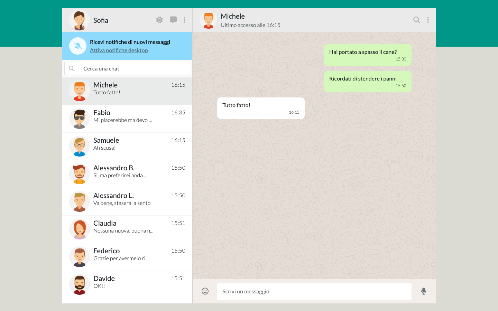

# Boolzapp

A simulated messaging interface, built as an individual project during the Boolean programme in **2023**. The work focuses on Vue, state management and coordinating contacts, conversations and user actions.

**[Open the demo](https://massimoperuga.dev/en/demo/boolzapp)** · [Project in my portfolio](https://massimoperuga.dev/en/formazione/boolean#boolzapp) · [Italiano](README.md)

[](https://massimoperuga.dev/en/demo/boolzapp)

The [original assignment and exercise documentation](CONSEGNA.md), in Italian, is preserved in full, including milestones and bonus features.

## What it includes

- A searchable contact list with last-message previews.
- Sending messages, automatic emoji replies and contact status updates.
- Creating and deleting chats, removing individual messages or clearing a conversation.
- Light/dark themes and navigation between the contact list and chat on mobile.

## My work

I built the interface by connecting contact and message data to user interactions. I developed the project incrementally, from displaying conversations to timed replies and the additional features collected in the `bonus/` directory.

## Stack and technical choices

| Area | Technologies |
| --- | --- |
| Interface and state | Vue 3, JavaScript, HTML |
| Styles and components | CSS, Bootstrap 5, Font Awesome |
| Dates and times | Luxon |

- **Reactive data:** contacts and messages are arrays of objects; `v-for`, `v-model` and conditional rendering connect state to the interface.
- **Timed replies:** timers simulate a reply and transitions between contact statuses.
- **Adaptive layout:** contacts and conversation sit side by side on desktop; smaller screens switch between the two views.

## Repository versions

The most complete final version is **[bonus/index.html](bonus/index.html)**, with application logic in [bonus/js/main.js](bonus/js/main.js) and styles in [bonus/css](bonus/css). The directories from `Milestone 1` to `milestone 5` preserve earlier increments.

## Running locally

You need **Python 3**, a current browser and an Internet connection for the libraries and fonts loaded from CDNs. The original version also uses Picsum for new chat avatars.

```sh
git clone https://github.com/MassimoPeruga/vue-boolzapp.git
cd vue-boolzapp
python3 -m http.server 5180 --bind 127.0.0.1
```

Open [http://127.0.0.1:5180/bonus/](http://127.0.0.1:5180/bonus/). No npm, build, database or credentials are required. Press `Ctrl+C` to stop the server.

Startup and interactions were checked in Chrome with Python 3.14.0, including a mobile viewport: search, sending and simulated replies, new chats, theme switching, contact scrolling and returning to the list.

## Original project and portfolio demo

Conversations are simulated and held in memory: reloading the page resets them. Messages are not delivered to other users.

The portfolio demo starts from `bonus/` and adds changes to selection and timer handling, keyboard and touch controls, locally served dependencies and adjustments to the site’s breakpoints. These changes live in the [portfolio adaptations](https://github.com/MassimoPeruga/portfolio/tree/production/site/demos), separately from this repository’s sources. The interface retains its original Italian content.
