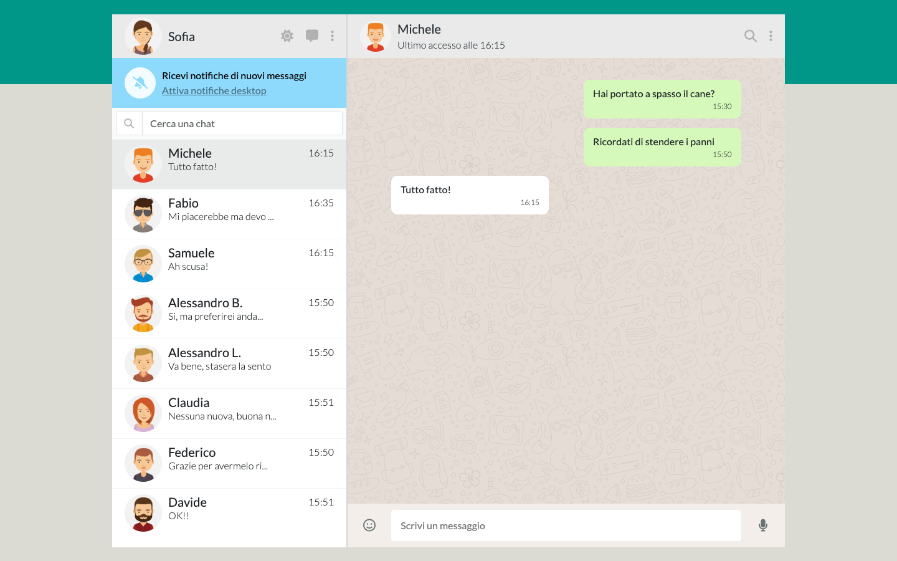

# Boolzapp

Interfaccia di messaggistica simulata, realizzata come progetto individuale del percorso Boolean nel **2023**. Il lavoro mette in pratica Vue, gestione dello stato e coordinamento tra lista dei contatti, conversazioni e azioni dell’utente.

**[Apri la demo](https://massimoperuga.dev/demo/boolzapp)** · [Il progetto nel portfolio](https://massimoperuga.dev/formazione/boolean#boolzapp) · [English](README.en.md)

[](https://massimoperuga.dev/demo/boolzapp)

La [consegna e documentazione originale dell’esercizio](CONSEGNA.md) è conservata integralmente, con milestone e bonus.

## Cosa include

- Lista dei contatti con ricerca e anteprima dell’ultimo messaggio.
- Invio di messaggi, risposte automatiche con emoji e aggiornamento dello stato del contatto.
- Creazione ed eliminazione delle chat, cancellazione di singoli messaggi o svuotamento della cronologia.
- Tema chiaro/scuro e navigazione tra lista e chat su mobile.

## Il mio lavoro

Ho costruito l’interfaccia collegando i dati di contatti e messaggi alle interazioni dell’utente. Ho sviluppato il progetto per incrementi, dalla visualizzazione delle conversazioni alle risposte temporizzate e alle funzioni aggiuntive raccolte nella cartella `bonus/`.

## Stack e scelte tecniche

| Ambito | Tecnologie |
| --- | --- |
| Interfaccia e stato | Vue 3, JavaScript, HTML |
| Stili e componenti | CSS, Bootstrap 5, Font Awesome |
| Date e orari | Luxon |

- **Dati reattivi:** contatti e messaggi sono array di oggetti; `v-for`, `v-model` e rendering condizionale collegano lo stato all’interfaccia.
- **Risposte temporizzate:** i timer simulano una risposta e il passaggio tra gli stati del contatto.
- **Layout adattivo:** su desktop lista e conversazione sono affiancate; su schermi più piccoli si passa da una vista all’altra.

## Versioni nella repository

La versione finale più completa si trova in **[bonus/index.html](bonus/index.html)**, con la logica in [bonus/js/main.js](bonus/js/main.js) e gli stili in [bonus/css](bonus/css). Le cartelle da `Milestone 1` a `milestone 5` conservano gli incrementi precedenti.

## Avvio locale

Servono **Python 3**, un browser aggiornato e una connessione Internet per le librerie e i font caricati da CDN. La versione originale usa anche Picsum per gli avatar delle nuove chat.

```sh
git clone https://github.com/MassimoPeruga/vue-boolzapp.git
cd vue-boolzapp
python3 -m http.server 5180 --bind 127.0.0.1
```

Apri [http://127.0.0.1:5180/bonus/](http://127.0.0.1:5180/bonus/). Non sono necessari npm, build, database o credenziali. Per fermare il server premi `Ctrl+C`.

Avvio e interazioni sono stati verificati in Chrome con Python 3.14.0, anche su viewport mobile: ricerca, invio e risposta simulata, nuova chat, tema, scorrimento dei contatti e ritorno alla lista.

## Progetto originale e demo del portfolio

Le conversazioni sono simulate e conservate in memoria: si azzerano ricaricando la pagina. I messaggi non vengono recapitati ad altri utenti.

La demo del portfolio parte dalla versione `bonus/` e aggiunge gestione della selezione e dei timer, controlli da tastiera e touch, dipendenze locali e adattamenti ai breakpoint del sito. Questi interventi risiedono negli [adattamenti del portfolio](https://github.com/MassimoPeruga/portfolio/tree/production/site/demos), separati dai sorgenti di questa repository. L’interfaccia mantiene i contenuti originali in italiano.
